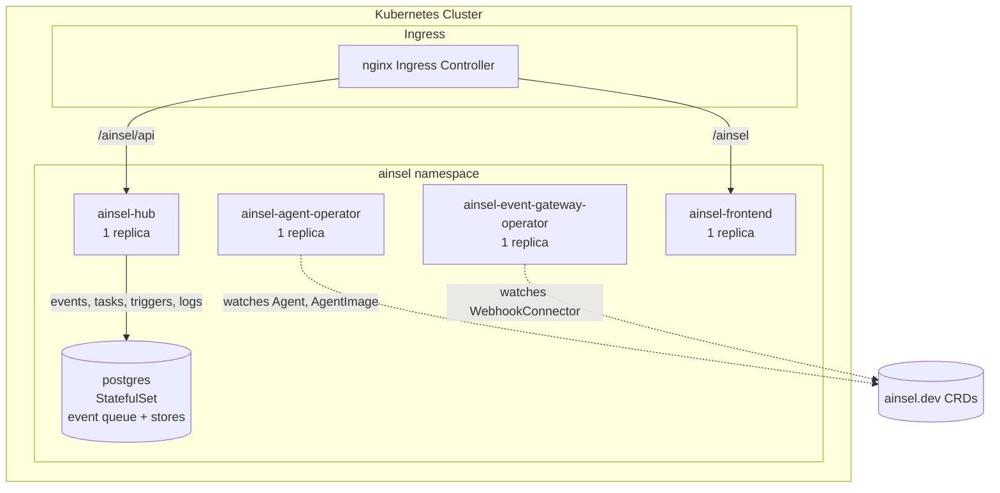
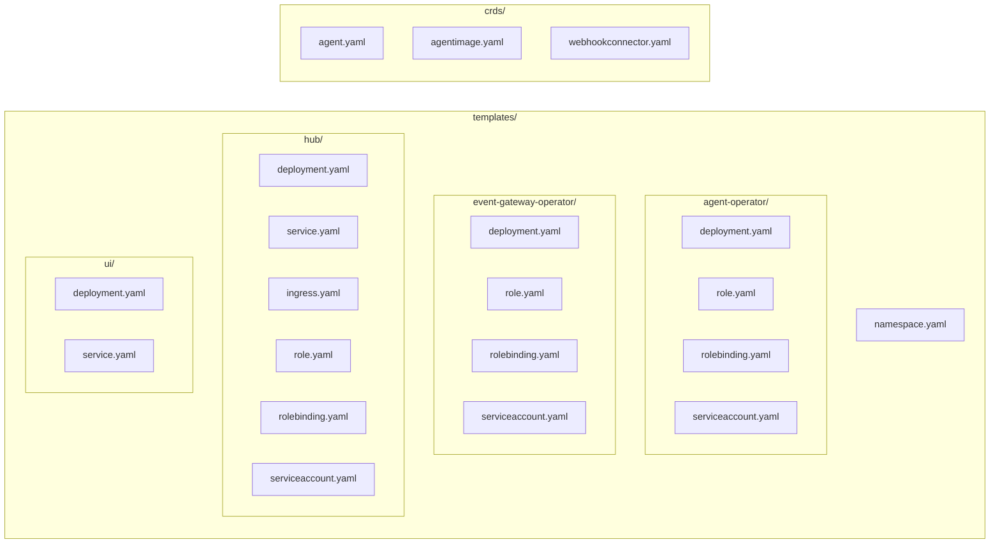

# Ainsel Chart Architecture

## Overview

The ainsel-chart is a Helm chart that deploys all Ainsel components into a single Kubernetes namespace. It creates the CRDs, operators, hub, UI, PostgreSQL, and optional bootstrap resources.

## Component names

Each component has exactly one name, used for its template directory, its
Kubernetes resources (`Deployment`, `Service`, `ServiceAccount`, `Ingress`),
its `app.kubernetes.io/component` label, and its top-level values key. The
name matches the component's directory in the code tree:

| Component | Code | Chart templates | Resource name | Values key |
|---|---|---|---|---|
| Agent operator | `operators/agent` | `templates/agent-operator/` | `agent-operator` | `agentOperator` |
| Event gateway operator | `operators/event-gateway` | `templates/event-gateway-operator/` | `event-gateway-operator` | `eventGatewayOperator` |
| Hub | `services/hub` | `templates/hub/` | `hub` | `hub` |
| Console | `frontend/` | `templates/frontend/` | `frontend` | `frontend` |

Deliberate exceptions: the MCP service stays `ainsel-mcp`, Postgres stays
`postgres`, and container image repositories keep their historical names
(e.g. `dpinsel/ainsel-hub-backend`). The operators label the resources they
create with `app.kubernetes.io/managed-by: agent-operator` /
`connector-operator`; those values are set in operator code and are not
chart resource names.

## Deployment Topology

## Template Structure

## CRDs

The chart includes three CRDs installed in the `crds/` directory (applied before templates):

| CRD | File | API Group |
|-----|------|-----------|
| Agent | `crds/agent.yaml` | `ainsel.dev/v1alpha1` |
| AgentImage | `crds/agentimage.yaml` | `ainsel.dev/v1alpha1` |
| WebhookConnector | `crds/webhookconnector.yaml` | `ainsel.dev/v1alpha1` |
