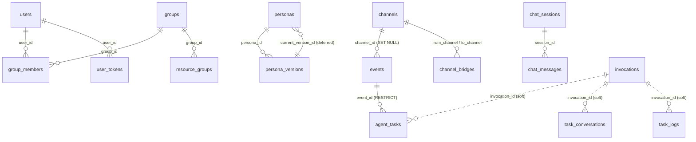

# Database Schema

Reference for the PostgreSQL schema behind the hub. It lists every table, its
columns, constraints and indexes, who writes to it, and how it is pruned — the
thing to read before adding a migration or reviewing one.

The hub is the **only** component that talks to PostgreSQL. `webhook-receiver`,
`chat-mcp`, `mcp`, the operators and the agent runtimes hold no SQL; their state
lives in CRDs, in the hub's API, or in the hub's tables via the internal HTTP
endpoints. Deployment-wise the database is the `postgres` StatefulSet in the
chart (`chart/templates/postgres/`), reached through the DSN in the generated
secret (`chart/templates/postgres/secret.yaml`), which the hub reads as
`HUB_DB_URL`.

---

## 1. How the schema is managed

| Concern | Setting |
|---------|---------|
| Migration tool | [golang-migrate](https://github.com/golang-migrate/migrate) v4, embedded with `//go:embed migrations/*.sql` |
| Migration files | `services/hub/internal/db/migrations/NNNN_name.up.sql` / `.down.sql` |
| Driver | `pgx/v5` (golang-migrate scheme `pgx5://`) |
| When it runs | `db.Migrate(ctx, dsn)` at hub startup; idempotent, safe on every boot |
| DSN form | URL form only (`postgres://…`); key/value DSNs are rejected outright |
| Transaction | One implicit transaction **per file** — no `CREATE INDEX CONCURRENTLY` inside a migration |
| Gap check | `checkMigrationSource` refuses to start if the embedded files skip a version — history must be contiguous |
| Dirty state | A failed migration leaves `schema_migrations.dirty = true`, which is a hard stop at the next startup |
| Pool | `pgxpool`: `MaxConns=10`, `MinConns=1`, `MaxConnLifetime=1h`, `MaxConnIdleTime=15m` |

Migrations are append-only. Several tables have been reshaped in place
(`mcp_servers` in 0005–0007, access control in 0016), so the current shape is
only readable as the sum of the files — §8 summarises that history.

### History integrity

`schema_migrations` records only the *highest* applied version. A database at
version 30 therefore cannot tell that the file behind version 26 was edited or
renumbered after deploy: `Up()` sees a database already at the newest version,
does nothing, and the schema keeps a permanent, invisible hole while the hub
starts up looking healthy.

The hub closes that gap with a second table of its own, `schema_history`
(`version BIGINT PK`, `checksum TEXT`, `applied_at TIMESTAMPTZ`), maintained by
`internal/db/history.go`: the sha256 of each `up.sql` as it was applied, compared
against the embedded files on every startup. A version whose recorded checksum
differs from the shipping file is drift, and the hub refuses to start. Note that
the table is created by the hub rather than by a migration — a database migrated
before it existed is baselined on first start, not flagged — and that recorded
versions with no matching file are accepted, because that is what a rollback looks
like. Recovery steps are in the
[Upgrade Guide](upgrade-guide.md#database-migrations).

---

## 2. Table map

Twenty-one tables in five domains:

| Domain | Tables | Character |
|--------|--------|-----------|
| Identity & access | `users`, `groups`, `group_members`, `resource_groups`, `user_tokens` | Small, low-churn, never pruned |
| Resource catalogue | `mcp_servers`, `personas`, `persona_versions`, `skills`, `triggers`, `cron_triggers`, `channels`, `channel_bridges` | Config; written by console/MCP/CRD reconcile |
| Chat | `chat_sessions`, `chat_messages` | User history; deleted by user action only |
| Event queue | `events`, `agent_tasks` | Hot path; high churn; **never pruned** |
| Observability & audit | `invocations`, `task_logs`, `task_conversations`, `auth_events` | Append-only telemetry; time-pruned (see §7) |

Two more tables live in the same database but are **not** part of the migration
set: `schema_migrations` (golang-migrate's version marker) and `schema_history`
(the hub's own per-version checksum record, §1).



Solid lines are real foreign keys; dotted lines are **soft references** — plain
`TEXT` columns with no constraint (§6).

---

## 3. Identity & access

### `users`

Hub-managed user record, synced lazily from Zitadel OIDC claims or created
locally for password auth (migration 0003, 0017).

| Column | Type | Notes |
|--------|------|-------|
| `id` | `TEXT` PK | ULID (uppercase, `ulid.Make()`) |
| `email` | `TEXT NOT NULL` | **No unique constraint** |
| `username` | `TEXT NOT NULL` | **No unique constraint** — for local users it is encoded in `id` (`local:{username}`), so uniqueness there holds by construction only |
| `is_admin` | `BOOLEAN NOT NULL DEFAULT FALSE` | Hub-wide admin flag |
| `password_hash` | `TEXT NOT NULL DEFAULT ''` | argon2id in PHC format; `''` = OIDC-only user |
| `disabled` | `BOOLEAN NOT NULL DEFAULT false` | 0026 — blocks login and all API access, but keeps group memberships and tokens so re-enabling restores access |
| `token_version` | `BIGINT NOT NULL DEFAULT 0` | 0027 — embedded as the `token_version` claim in local session JWTs; the localauth middleware rejects older claims. Bumped by `SetPassword` and `BumpTokenVersion` (sign out everywhere) |
| `must_change_password` | `BOOLEAN NOT NULL DEFAULT false` | 0029 — set for the chart-bootstrapped admin and for accounts whose password an admin created or reset. Meaningless on OIDC-only rows; the store never sets it there |
| `created_at` / `updated_at` | `TIMESTAMPTZ NOT NULL DEFAULT now()` | |

Writer: `internal/authz/store.go`. Deleted explicitly (`DeleteUser`); no
dependent FK from `chat_sessions` (see §6).

### `groups`

Flat groups — the `parent_id` hierarchy from 0003 was removed in 0016.

| Column | Type | Notes |
|--------|------|-------|
| `id` | `TEXT` PK | ULID, except the synthetic `'legacy'` group created by migration 0016 |
| `name` | `TEXT NOT NULL UNIQUE` | |
| `description` | `TEXT NOT NULL DEFAULT ''` | |
| `created_at` / `updated_at` | `TIMESTAMPTZ NOT NULL DEFAULT now()` | |

### `group_members`

Many-to-many, with a role per membership (role added in 0016).

| Column | Type | Notes |
|--------|------|-------|
| `group_id` | `TEXT NOT NULL` → `groups(id)` ON DELETE CASCADE | |
| `user_id` | `TEXT NOT NULL` → `users(id)` ON DELETE CASCADE | |
| `role` | `TEXT NOT NULL DEFAULT 'reader' CHECK (role IN ('reader','writer','owner'))` | owner > writer > reader |
| | | PK `(group_id, user_id)` |

Index: `idx_group_members_user_id (user_id)`.

### `resource_groups`

The access-control join: one group per resource, plus public visibility.
Replaces `resource_ownership` + `resource_access` (dropped in 0016).

| Column | Type | Notes |
|--------|------|-------|
| `resource_type` | `TEXT NOT NULL` | Values written by the API: `persona`, `skill`, `mcp-server`, `trigger`, `cron-trigger`, `channel`, `agent`, `agent-image`, `connector` |
| `resource_name` | `TEXT NOT NULL` | Resource **id** for every type except `mcp-server`, which uses the **name** |
| `group_id` | `TEXT NOT NULL` → `groups(id)` ON DELETE CASCADE | |
| `public` | `BOOLEAN NOT NULL DEFAULT false` | Readable by everyone when true |
| `created_at` | `TIMESTAMPTZ NOT NULL DEFAULT now()` | |
| | | PK `(resource_type, resource_name)` |

Index: `idx_resource_groups_group (group_id)`. There is no FK to the resource
itself — the key is a `(type, name)` pair, so the row outlives (or precedes) the
resource it names. Cleanup is done by the API handlers, which log
`"resource group cleanup failed"` and continue.

### `user_tokens`

API tokens for machine access (migration 0004).

| Column | Type | Notes |
|--------|------|-------|
| `id` | `TEXT` PK | ULID |
| `user_id` | `TEXT NOT NULL` → `users(id)` ON DELETE CASCADE | |
| `name` | `TEXT NOT NULL` | Label for the console |
| `token_hash` | `TEXT NOT NULL UNIQUE` | SHA-256 of the token; the plaintext is returned once, at creation |
| `expires_at` | `TIMESTAMPTZ NOT NULL` | |
| `last_used_at` | `TIMESTAMPTZ` | |
| `revoked_at` | `TIMESTAMPTZ` | Soft delete — authentication requires `revoked_at IS NULL`; rows are never removed |
| `created_at` | `TIMESTAMPTZ NOT NULL DEFAULT now()` | |

Indexes: `idx_user_tokens_user_id`, `idx_user_tokens_token_hash` (the latter
duplicates the unique constraint). Writer: `internal/usertokens/store.go`.

---

## 4. Resource catalogue

### `mcp_servers`

External MCP servers the hub can expose to agents (0001, reshaped in 0005–0007).

| Column | Type | Notes |
|--------|------|-------|
| `id` | `BIGSERIAL PK` | Surrogate only — every query addresses `name` |
| `name` | `TEXT NOT NULL UNIQUE` | De-facto key |
| `display_name` | `TEXT NOT NULL` | |
| `description` | `TEXT NOT NULL DEFAULT ''` | |
| `url` | `TEXT NOT NULL DEFAULT ''` | Replaced `image_repo`/`image_tag`/`port`/`path` |
| `token_from_env` | `TEXT NOT NULL DEFAULT ''` | Env var *name* holding the bearer token (was `bearer_token`) |
| `managed_by` | `TEXT NOT NULL DEFAULT 'user'` | `'user'` \| `'helm'`; only changed via `Upsert`, never by `Update` |
| `created_at` / `updated_at` | `TIMESTAMPTZ NOT NULL DEFAULT now()` | |

Index: `idx_mcp_servers_managed_by`. Writer: `internal/mcpservers/store.go`.

### `personas` / `persona_versions`

A persona is a prompt template with an append-only version history. Since 0019
there are two classes: shared **templates** (`owner_agent IS NULL`) and
agent-owned **copies** created copy-on-write when an agent's persona is edited
inline.

`personas`

| Column | Type | Notes |
|--------|------|-------|
| `id` | `TEXT` PK | Lowercased ULID |
| `name` | `TEXT NOT NULL` | Unique **among templates only** — partial unique index `personas_name_templates_unique` |
| `description` | `TEXT NOT NULL DEFAULT ''` | |
| `current_version_id` | `BIGINT NOT NULL` → `persona_versions(id)`, `DEFERRABLE INITIALLY DEFERRED` | Cycle with `persona_versions.persona_id`; deferred so a persona and its v1 can be inserted in one transaction |
| `owner_agent` | `TEXT` (nullable) | Agent CR name for owned copies; not an FK |
| `created_at` / `updated_at` | `TIMESTAMPTZ NOT NULL DEFAULT now()` | |

Index: `idx_personas_owner_agent (owner_agent) WHERE owner_agent IS NOT NULL`.

`persona_versions`

| Column | Type | Notes |
|--------|------|-------|
| `id` | `BIGSERIAL PK` | |
| `persona_id` | `TEXT NOT NULL` → `personas(id)` ON DELETE CASCADE | |
| `version_number` | `INTEGER NOT NULL` | `UNIQUE (persona_id, version_number)` |
| `text` | `TEXT NOT NULL` | The prompt body |
| `created_at` | `TIMESTAMPTZ NOT NULL DEFAULT now()` | |

Index: `idx_persona_versions_persona_id`. Deleting a persona cascades to its
versions; deleting a version that is still `current_version_id` is refused
(default `NO ACTION`).

### `skills`

Skill registry (0008, tags in 0015).

| Column | Type | Notes |
|--------|------|-------|
| `id` | `TEXT` PK | Caller-supplied (request `id`, length-validated), not generated by the store |
| `name` | `TEXT NOT NULL` | Not unique |
| `description` | `TEXT NOT NULL DEFAULT ''` | |
| `body` | `TEXT NOT NULL DEFAULT ''` | Markdown body; rendered to a ConfigMap by skills delivery |
| `tags` | `TEXT[] NOT NULL DEFAULT '{}'` | |
| `managed_by` | `TEXT NOT NULL DEFAULT 'user'` | 0030 — `'user'` \| `'plugin'`; only the plugin registry syncer writes `'plugin'`, and user-facing update/delete of such a row is refused. Not an input to `Create` |
| `created_at` / `updated_at` | `TIMESTAMPTZ NOT NULL DEFAULT NOW()` | |

### `triggers` / `cron_triggers`

Routing rules, moved out of CRDs into the database (0011); the one-time
`cmd/migrate-triggers` tool imports existing CRs.

`triggers` — an event-source → agent transfer, i.e. a connector channel into an
agent inbox.

| Column | Type | Notes |
|--------|------|-------|
| `id` | `TEXT` PK | `t-{8 hex}` |
| `display_name` | `TEXT NOT NULL DEFAULT ''` | |
| `agent_ref` | `TEXT NOT NULL` | Agent CR name — soft reference |
| `connector_ref` | `TEXT NOT NULL` | WebhookConnector CR name — soft reference |
| `filters` | `JSONB NOT NULL DEFAULT '[]'` | List of `shared.Filter` |
| `agent_valid` / `connector_valid` | `BOOLEAN NOT NULL DEFAULT false` | Reconcile-time validity stamps |
| `created_at` / `updated_at` | `TIMESTAMPTZ NOT NULL DEFAULT now()` | |

Indexes: `idx_triggers_agent_ref`, `idx_triggers_connector_ref`.

`cron_triggers` — a scheduled synthetic event.

| Column | Type | Notes |
|--------|------|-------|
| `id` | `TEXT` PK | `c-{8 hex}` |
| `display_name` | `TEXT NOT NULL DEFAULT ''` | |
| `agent_ref` | `TEXT NOT NULL` | |
| `schedule` | `TEXT NOT NULL` | Cron expression; validity in `schedule_valid` |
| `prompt` | `TEXT NOT NULL DEFAULT ''` | |
| `enabled` | `BOOLEAN NOT NULL DEFAULT true` | |
| `agent_valid` / `schedule_valid` | `BOOLEAN NOT NULL DEFAULT false` | |
| `last_run` / `next_run` | `TIMESTAMPTZ` | |
| `created_at` / `updated_at` | `TIMESTAMPTZ NOT NULL DEFAULT now()` | |

Index: `idx_cron_triggers_agent_ref`.

### `channels` / `channel_bridges`

Channels make the named event streams addressable (0020). A channel has no role:
it neither produces nor consumes. Identity is always `id`; `name` is a rename-able
label and deliberately **not** unique.

`channels`

| Column | Type | Notes |
|--------|------|-------|
| `id` | `TEXT` PK | `ch-{8 hex}` |
| `kind` | `TEXT NOT NULL CHECK (kind IN ('connector','agent','custom'))` | `connector`/`agent` are provisioned and permanent; `custom` is user-created and deletable |
| `name` | `TEXT NOT NULL` | Display label, non-unique |
| `description` | `TEXT NOT NULL DEFAULT ''` | |
| `entity_ref` | `TEXT` (nullable) | Registry id it was provisioned for (WebhookConnector or Agent CR name); null only for `custom` |
| `orphaned` | `BOOLEAN NOT NULL DEFAULT false` | Registry entity is gone; rows are never deleted with it |
| `created_at` / `updated_at` | `TIMESTAMPTZ NOT NULL DEFAULT now()` | |

Indexes: `idx_channels_entity (kind, entity_ref) WHERE entity_ref IS NOT NULL`
(unique — makes provisioning idempotent), `idx_channels_kind`.

`channel_bridges` — subscriptions between channels that are not triggers, so N
sources can be bundled once and consumed by M inboxes.

| Column | Type | Notes |
|--------|------|-------|
| `id` | `TEXT` PK | `br-{8 hex}` |
| `name` | `TEXT NOT NULL DEFAULT ''` | |
| `from_channel` | `TEXT NOT NULL` → `channels(id)` ON DELETE CASCADE | |
| `to_channel` | `TEXT NOT NULL` → `channels(id)` ON DELETE CASCADE | |
| `created_at` / `updated_at` | `TIMESTAMPTZ NOT NULL DEFAULT now()` | |
| | | `CHECK (from_channel <> to_channel)`, `UNIQUE (from_channel, to_channel)` |

Indexes: `idx_channel_bridges_from`, `idx_channel_bridges_to`. Two rules are
enforced **in the store, not the schema**: at least one endpoint must be
`custom`, and the graph must stay acyclic (`internal/channels/store.go`,
`ErrNoCustomEndpoint`, `ErrCycle`; traversal is bounded by `maxWalkDepth = 8`).

---

## 5. Runtime data

### `chat_sessions` / `chat_messages`

Console chat (0009, session name in 0010).

`chat_sessions`

| Column | Type | Notes |
|--------|------|-------|
| `id` | `TEXT` PK | `sess-{8 hex}` |
| `name` | `TEXT NOT NULL` | Added in 0010 with `DEFAULT ''`, backfilled to `id`, then the default was **dropped** — an insert that omits it fails |
| `agent_name` | `TEXT NOT NULL` | Soft reference to the Agent CR |
| `user_id` | `TEXT NOT NULL` | Soft reference to `users(id)` — no FK, so sessions survive user deletion |
| `created_at` / `updated_at` | `TIMESTAMPTZ NOT NULL DEFAULT NOW()` | |

Indexes: `idx_chat_sessions_agent`, `idx_chat_sessions_user`.

`chat_messages`

| Column | Type | Notes |
|--------|------|-------|
| `id` | `BIGSERIAL PK` | |
| `session_id` | `TEXT NOT NULL` → `chat_sessions(id)` ON DELETE CASCADE | |
| `role` | `TEXT NOT NULL` | Unconstrained (`user` / `assistant` / …) |
| `content` | `TEXT NOT NULL` | |
| `tokens` | `INTEGER NOT NULL DEFAULT 0` | |
| `created_at` | `TIMESTAMPTZ NOT NULL DEFAULT NOW()` | |

Index: `idx_chat_messages_session (session_id, created_at)`. Deleting a session
cascades; nothing else prunes this table.

### `events`

Every ingested event, whatever its origin (0014; `channel_id` in 0020). This is
the queue's ingest log and the console's event history.

| Column | Type | Notes |
|--------|------|-------|
| `id` | `TEXT` PK | Assigned by the publisher: `cron-{16 hex}` for cron ticks, `chat-{sessionId}-{messageId}` for chat, connector-chosen otherwise |
| `connector` | `TEXT NOT NULL` | WebhookConnector CR name, or a pseudo-source (`cron`, `chat`) for events the hub emits itself |
| `channel_id` | `TEXT` (nullable) → `channels(id)` ON DELETE SET NULL | Birth channel; stamped at ingest, backfilled for old rows |
| `headers` | `JSONB NOT NULL DEFAULT '{}'` | |
| `data` | `JSONB NOT NULL` | Parsed payload |
| `raw` | `TEXT NOT NULL DEFAULT ''` | Raw webhook body — the largest column in the schema |
| `received_at` | `TIMESTAMPTZ NOT NULL DEFAULT now()` | |
| `routed_at` | `TIMESTAMPTZ` | Stamped once the router has processed the event — **including when nothing matched**. `NULL` therefore means "not processed yet" (a restart re-routes these), not "matched nothing" |

Indexes: `idx_events_unrouted (received_at) WHERE routed_at IS NULL` (the
router's 2s poll), `idx_events_channel (channel_id) WHERE channel_id IS NOT
NULL`, `idx_events_received_at (received_at)` (0021, for metric windows).

Written by `POST /api/internal/events` (webhook-receiver), the cron emitter, and
the chat handler — all via `internal/eventqueue/store.go`. `INSERT … ON CONFLICT
(id) DO NOTHING` makes redelivery idempotent.

### `agent_tasks`

One row per (event, agent) delivery — the fan-out and the agent inbox.

| Column | Type | Notes |
|--------|------|-------|
| `id` | `BIGSERIAL PK` | |
| `event_id` | `TEXT NOT NULL` → `events(id)` (**no ON DELETE** = RESTRICT) | An event with tasks cannot be deleted |
| `agent_name` | `TEXT NOT NULL` | Soft reference — the inbox key |
| `trigger_name` | `TEXT NOT NULL DEFAULT ''` | Soft reference |
| `invocation_id` | `TEXT NOT NULL DEFAULT ''` | Soft reference to `invocations.id` |
| `headers` | `JSONB NOT NULL DEFAULT '{}'` | |
| `payload` | `JSONB NOT NULL` | |
| `status` | `TEXT NOT NULL DEFAULT 'pending'` | `pending` \| `claimed` \| `completed` \| `failed` — no CHECK constraint |
| `attempts` | `INT NOT NULL DEFAULT 0` | |
| `max_attempts` | `INT NOT NULL DEFAULT 10` | A nack past this flips to `failed` |
| `retry_after` | `TIMESTAMPTZ` | Backoff window; `retry_after IS NULL OR retry_after <= now()` is applied at query time (now() is not indexable in a predicate) |
| `claimed_at` | `TIMESTAMPTZ` | Also used as "started" evidence |
| `completed_at` | `TIMESTAMPTZ` | |
| `error` | `TEXT NOT NULL DEFAULT ''` | Last failure message |
| `created_at` | `TIMESTAMPTZ NOT NULL DEFAULT now()` | |
| | | `UNIQUE (event_id, agent_name)` — the dedup guard |

Indexes: `idx_agent_tasks_pending (agent_name, created_at) WHERE status =
'pending'` (the claim query), `idx_agent_tasks_status (status)`,
`idx_agent_tasks_created_at (created_at)` (0021).

Lifecycle: claim (`status='claimed'`, `attempts+1`) → ack (`completed`) / nack
(back to `pending` with `retry_after`, or `failed` at `max_attempts`). A reaper
returns stale `claimed` rows to the pool. Claim/ack/nack fire
`SetQueueObserver` → queue-depth signal for the operator, and `pg_notify
'agent_tasks'` wakes long-polling agents (LISTEN/NOTIFY is advisory only — no
queue table, no trigger).

### `invocations`

One dispatch of an event to an agent, with its outcome (0018). Replaces the
former in-memory ring buffer so transcripts survive a hub restart.

| Column | Type | Notes |
|--------|------|-------|
| `id` | `TEXT` PK | `inv-{8 hex}`; referenced by `agent_tasks.invocation_id`, `task_logs.invocation_id`, `task_conversations.invocation_id` |
| `agent_name` | `TEXT NOT NULL` | Soft reference |
| `trigger_name` | `TEXT NOT NULL DEFAULT ''` | |
| `event_id` | `TEXT NOT NULL DEFAULT ''` | Soft reference |
| `connector` | `TEXT NOT NULL DEFAULT ''` | |
| `status` | `TEXT NOT NULL DEFAULT 'running'` | Stored: `running` at dispatch, then `success` \| `failure` \| `timeout`. Derived, never stored: `queued` (from the task row) and `unknown` (no task, no terminal record); no CHECK constraint |
| `error` | `TEXT NOT NULL DEFAULT ''` | |
| `start_time` | `TIMESTAMPTZ NOT NULL` | Pruning key |
| `end_time` | `TIMESTAMPTZ` | |
| `duration_ms` | `BIGINT` | |

Indexes: `idx_invocations_agent (agent_name, start_time DESC)`,
`idx_invocations_event (event_id) WHERE event_id != ''`,
`idx_invocations_status (status) WHERE status = 'running'`.

Both a `MemoryStore` and a `PgStore` implement the `Store` interface; the
Postgres one is used when the DB is configured.

### `task_logs`

Structured agent logs (0012).

| Column | Type | Notes |
|--------|------|-------|
| `id` | `BIGSERIAL PK` | |
| `invocation_id` | `TEXT NOT NULL DEFAULT ''` | Soft reference |
| `correlation_id` | `TEXT NOT NULL DEFAULT ''` | Groups a run before an invocation id exists |
| `agent_name` | `TEXT NOT NULL` | |
| `level` | `TEXT NOT NULL DEFAULT 'info'` | `debug` \| `info` \| `warn` \| `error` (`internal/tasklogs/types.go`); no CHECK |
| `message` | `TEXT NOT NULL` | |
| `fields` | `JSONB NOT NULL DEFAULT '{}'` | |
| `created_at` | `TIMESTAMPTZ NOT NULL DEFAULT now()` | |

Indexes: `idx_task_logs_agent (agent_name, created_at DESC)`,
`idx_task_logs_invocation (invocation_id) WHERE invocation_id != ''`,
`idx_task_logs_level (level, created_at DESC) WHERE level = 'error'` (also
covers the dashboard's error series).

### `task_conversations`

The transcript: one row per assistant/user message reported by a runtime
(0013), later widened with token, cost and subject dimensions (0022–0024) so the
console's token/cost tables come from the hub's own records instead of
Prometheus only.

| Column | Type | Notes |
|--------|------|-------|
| `id` | `BIGSERIAL PK` | |
| `invocation_id` | `TEXT NOT NULL DEFAULT ''` | Soft reference |
| `correlation_id` | `TEXT NOT NULL DEFAULT ''` | |
| `agent_name` | `TEXT NOT NULL` | |
| `role` | `TEXT NOT NULL DEFAULT 'assistant'` | |
| `content` | `TEXT NOT NULL` | |
| `model` | `TEXT NOT NULL DEFAULT ''` | |
| `input_tokens` | `INTEGER NOT NULL DEFAULT 0` | Excludes cache traffic — pi reports `usage.input` without it |
| `output_tokens` | `INTEGER NOT NULL DEFAULT 0` | |
| `cache_read_tokens` | `INTEGER` (nullable since 0025) | 0022; `NULL` = not reported, `0` = measured zero. Legacy zeros were NULLed by 0025 |
| `cache_write_tokens` | `INTEGER` (nullable since 0025) | 0022 |
| `cost_usd` | `DOUBLE PRECISION` (nullable since 0025) | 0023; `usage.cost.total` from pi |
| `repo` / `org` / `event_type` | `TEXT NOT NULL DEFAULT ''` | 0024 subject dimensions; readers show "unknown" for empty |
| `issue_number` | `INTEGER NOT NULL DEFAULT 0` | 0024 |
| `stop_reason` | `TEXT NOT NULL DEFAULT ''` | |
| `created_at` | `TIMESTAMPTZ NOT NULL DEFAULT now()` | |

Indexes: `idx_task_conversations_agent (agent_name, created_at DESC)`,
`idx_task_conversations_invocation (invocation_id) WHERE invocation_id != ''`,
`idx_task_conversations_correlation (correlation_id) WHERE correlation_id != ''`,
`idx_task_conversations_subject (agent_name, repo, event_type, created_at DESC)`
(0024).

**Absence vs zero (0025).** A provider that never reports prompt-cache figures
must not look like one that reports `0`. `cache_read_tokens`,
`cache_write_tokens` and `cost_usd` are nullable, the ingest path writes `NULL`
for an unreported figure and a real number otherwise (including a reported `0`),
and every stored `0` from before the migration was rewritten to `NULL` — those
zeros were all written by a path that flattened absence into zero, so none of
them was a measurement. Read paths keep `COALESCE(SUM(...), 0)` for the numeric
and derive honest presence flags from `COUNT(col) > 0` (`CacheReported`,
`CostReported` in `internal/tasklogs/types.go`).

---

### `auth_events`

The auth audit trail (0028). These were slog lines only (`log_type=auth_event`),
invisible without cluster log access; the table makes them readable from the hub
API and console. The row set is deliberately narrow so "no secrets in the rows"
is auditable at a glance — none of the six write sites has a password or token in
scope, and the insert helper takes only these fields.

| Column | Type | Notes |
|--------|------|-------|
| `id` | `BIGINT GENERATED ALWAYS AS IDENTITY PRIMARY KEY` | The only identity column in the schema — everything else uses `BIGSERIAL` |
| `occurred_at` | `TIMESTAMPTZ NOT NULL DEFAULT now()` | Pruning key |
| `actor_sub` | `TEXT NOT NULL` | Subject of the acting principal; soft reference |
| `event_type` | `TEXT NOT NULL` | `auth_login`, `auth_login_failed`, `auth_password_changed`, `user_created`, `user_password_reset`, `user_deleted` — the slog names, so a row correlates 1:1 with its log line; no CHECK |
| `target` | `TEXT NOT NULL DEFAULT ''` | e.g. the user a password was reset for |
| `source_ip` | `TEXT NOT NULL DEFAULT ''` | |
| `outcome` | `TEXT NOT NULL` | |

Indexes: `idx_auth_events_occurred (occurred_at DESC)` (list endpoint),
`idx_auth_events_actor (actor_sub)`, `idx_auth_events_type_occurred (event_type,
occurred_at DESC)`. Writer: `internal/auditevents/store.go`. This is the only
table with an explicit row cap as well as an age limit (§7).

---

## 6. Conventions

**Identifiers.** `TEXT` primary keys, generated in Go, never by the database
(except the `BIGSERIAL` on the append-only tables). Formats in use:

| Shape | Used by |
|-------|---------|
| ULID, uppercase | `users`, `groups`, `user_tokens` |
| ULID, lowercased | `personas` |
| `{prefix}-{8 hex}` | `channels` (`ch-`), `channel_bridges` (`br-`), `chat_sessions` (`sess-`), `invocations` (`inv-`), `triggers` (`t-`), `cron_triggers` (`c-`) |
| `{prefix}-{16 hex}` / composite | `events` (`cron-`, `chat-{session}-{message}`) |
| Caller-supplied | `skills` |
| `BIGSERIAL` | `persona_versions`, `chat_messages`, `task_logs`, `task_conversations`, `agent_tasks`, `mcp_servers.id` |
| `GENERATED ALWAYS AS IDENTITY` | `auth_events.id` |

Four implementations produce the `{prefix}-{8 hex}` shape — `api.generateID`
(prefix argument), `channels.newID` (prefix argument), `chat.generateSessionID`
and `invocations.generateID` (prefix baked in). Same result, no shared helper.
Prefixes are not a namespace either: `handlers_connectors.go` uses `c-`, the same
prefix `cron_triggers` gets.

**Timestamps.** `TIMESTAMPTZ NOT NULL DEFAULT now()` everywhere; `updated_at` is
set by Go (`time.Now().UTC()`), not by a trigger.

**Soft references.** `agent_name`, `trigger_name`, `event_id`, `invocation_id`,
`correlation_id`, `owner_agent`, `agent_ref`, `connector_ref` are plain `TEXT`
with no FK. This is deliberate for observability rows (an agent's history must
outlive the agent) but it means orphaned rows are a normal state that readers
have to tolerate — the enrichment queries in `internal/eventqueue/store.go`
already expect tasks whose invocation record was pruned.

**JSONB.** `headers`, `data`, `payload`, `fields`, `filters`, plus
`channels`-adjacent config. No GIN indexes: nothing queries inside a JSON
document.

**Partial indexes.** The hot paths are partial (`WHERE status = 'pending'`,
`WHERE routed_at IS NULL`, `WHERE invocation_id != ''`). Empty string, not NULL,
is the "absent" marker in the 0012–0014 tables — which is why those indexes test
`!= ''`.

**Status values are application enums.** No status column has a CHECK
constraint: `agent_tasks.status`, `invocations.status`, `task_logs.level` and
`chat_messages.role` are free text. The only value sets the schema enforces are
`channels.kind`, `group_members.role`, and `channel_bridges`' self-edge check.

---

## 7. Retention & growth

Two hourly tickers in `services/hub/cmd/hub/main.go` do the pruning, both
non-fatal:

| Table | Retention | Extra bound | Where |
|-------|-----------|-------------|-------|
| `task_logs` | 7 days | — | `tasklogs.DefaultRetention` |
| `task_conversations` | 7 days | — | `tasklogs.ConversationRetention` |
| `invocations` | 7 days | — | `invocations.Retention` |
| `auth_events` | 90 days (default) | 100,000 rows, newest kept | `HUB_AUTH_EVENT_RETENTION_DAYS`, `HUB_AUTH_EVENT_MAX_ROWS` |

The three observability retentions are deliberately equal so an invocation
record, its transcript and its log lines expire together — a run is either
fully readable or gone. Age is applied before the auth-event row cap: age is the
privacy/compliance lever, the cap is burst protection between sweeps.

Everything else is unbounded. The notable cases:

- **`events` and `agent_tasks` are never pruned.** Both are append-only on the
  hot path, and `events.raw` keeps the full webhook body. Growth here is the
  schema's main capacity question, and it is the one hot-path table pair with no
  operator-facing retention knob.
- Deleting an `event` that has tasks is blocked by the RESTRICT FK on
  `agent_tasks.event_id`, so adding event pruning later needs that edge
  reconsidered (`ON DELETE CASCADE`, or delete tasks first).
- `chat_sessions` / `chat_messages` expire only when a user deletes a session.
- `channels` rows are kept on purpose after their entity disappears
  (`orphaned = true`), because `events.channel_id` history is worth reading.
- `group_members` and `user_tokens` survive a disabled user (0026) so
  re-enabling restores access; revoked tokens are never deleted, only stamped.

Separate from retention, a 5-minute reaper returns stale `claimed` tasks to the
pool (`ReapStaleClaims`, timeout `TASK_CLAIM_TIMEOUT_SECONDS`, default 1800s); a
reaped task past `max_attempts` goes to `failed` instead.

## 8. Schema evolution

Useful when reading an old deployment's schema or reviewing a new migration.

| Migration | Change |
|-----------|--------|
| 0001–0004 | `mcp_servers`, `personas` + versions, access control (`users`, `groups` w/ hierarchy, `group_members`, `resource_ownership`, `resource_access`), `user_tokens` |
| 0005–0007 | `mcp_servers` reshaped from "container we run" to "URL we proxy": image/port/path/env columns dropped for `url` + `token_from_env`; `managed_by` re-added |
| 0008–0011 | `skills`, chat tables, `chat_sessions.name`, `triggers` + `cron_triggers` (CRD → DB; `cmd/migrate-triggers` is the importer) |
| 0012–0014 | `task_logs`, `task_conversations`, and the Postgres event queue (`events`, `agent_tasks`) replacing NATS JetStream |
| 0015–0017 | `skills.tags`; access control rebuilt as flat groups + `resource_groups` (old ownership tables dropped, data migrated into a `legacy` group); `users.password_hash` for local auth |
| 0018 | `invocations`, persisted across restarts |
| 0019 | Persona templates vs agent-owned copies; name uniqueness becomes partial |
| 0020 | `channels` + `channel_bridges`; `events.channel_id` |
| 0021 | Full (non-partial) indexes on `events.received_at` and `agent_tasks.created_at` for metric panels |
| 0022–0024 | `task_conversations`: cache tokens, `cost_usd`, subject dimensions + subject index |
| 0025 | Cache figures and cost become nullable: `NULL` means "not reported", legacy zeros are rewritten to `NULL` |
| 0026–0027, 0029 | `users`: `disabled`, `token_version` (local session invalidation), `must_change_password` |
| 0028 | `auth_events` — the auth audit trail, readable from the API instead of only from logs |
| 0030 | `skills.managed_by` — plugin-owned skill rows, mirroring `mcp_servers.managed_by` |

---

## 9. Review notes

Points worth a decision rather than a correction — each is current, intentional
or at least consistent behaviour, but a schema review should confirm it:

1. **Unbounded `events` / `agent_tasks`.** No retention, and `events.raw` keeps
   full webhook bodies. Either a retention policy or a documented "runs forever"
   expectation is needed for long-lived installs.
2. **`users.email` and `users.username` have no unique constraint.** OIDC users
   are upserted by claim id, so duplicates are possible in the columns.
   Local-auth login does not read `username` either — it derives the id as
   `local:{username}` and reads the hash by id, so uniqueness holds only because
   the id is derived, not because the column is constrained.
3. **`mcp_servers.id` is a decorative surrogate.** Everything addresses `name`,
   including `resource_groups.resource_name`. Renaming a server orphans its
   access row.
4. **`resource_groups.resource_name` mixes two conventions.** It holds a resource
   *id* for personas, skills, channels and triggers, but the resource *name* for
   MCP servers — so `DeleteResourceGroup` callers must know which one each type
   uses.
5. **Money in `DOUBLE PRECISION`.** `cost_usd` is a nullable float; fine for
   display totals and for `SUM`, wrong if anything ever bills on it.
6. **Status columns are unconstrained text** — `agent_tasks.status`,
   `invocations.status`, `task_logs.level`, `chat_messages.role` and
   `auth_events.event_type` (§6). A typo in a writer becomes an unreachable row
   rather than an error, and the dashboard filters (`WHERE status = 'pending'`)
   silently under-count.
7. **Migration-time locks.** 0021, 0024 and 0028 all say so explicitly: no
   `CONCURRENTLY` inside golang-migrate, so a large queue table means a brief
   write pause on upgrade.
8. **`0010` left `chat_sessions.name` NOT NULL with no default.** The hub always
   supplies it, but any external insert omitting the column fails.
9. **Dropped defaults and dropped columns are recorded only in migrations** —
   the live shape is not obvious from the newest file; this page is the
   reconciled view.
10. **Small guard-style drift.** 0025–0030 are written with `IF NOT EXISTS`
    (0028 included) where 0001–0024 are not, and `auth_events` is the only
    `GENERATED ALWAYS AS IDENTITY` key. Harmless, but the next migration has to
    pick a side in each of those.

---

## 10. Working with the schema

Inspect a live database:

```bash
# Tables, with row counts (rough, from the catalog)
psql "$HUB_DB_URL" -c "SELECT relname, n_live_tup FROM pg_stat_user_tables ORDER BY n_live_tup DESC;"

# Current migration version
psql "$HUB_DB_URL" -c "SELECT version, dirty FROM schema_migrations;"

# Per-version checksums the hub compares against the image on startup (§1)
psql "$HUB_DB_URL" -c "SELECT version, left(checksum, 8) AS ck, applied_at FROM schema_history ORDER BY version DESC LIMIT 10;"

# Every index behind the hot paths
psql "$HUB_DB_URL" -c "\di idx_*"
```

Adding a migration:

1. `touch services/hub/internal/db/migrations/00NN_name.{up,down}.sql` — next
   number, no gaps; both directions, down undoing up.
2. No `CREATE INDEX CONCURRENTLY` (one transaction per file). If an index is
   expensive, note the write pause in a comment, as 0021 does.
3. Prefer additive changes; the hub reads columns that old rows may not have,
   so give new columns a `NOT NULL DEFAULT` and treat pre-migration rows as
   "unknown", not missing.
4. Add the reason in the file — every existing migration comment explains *why*
   the change exists, often with an issue number.
5. Extend `internal/db/migrations_test.go` (it runs `Migrate` against a real
   Postgres and asserts idempotency) and update the relevant section of this
   document.

Related: [Architecture](architecture.md) (where the queue sits in the data
flow), [Access Control](access-control.md) (`groups` / `resource_groups`
semantics), [Event Schema](event-schema.md) (`events.data` / `raw` content),
[Observability](observability.md) (what the metric panels read from
`task_conversations` and `invocations`).
