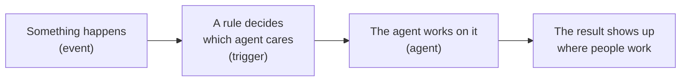

# Why AInsel

Most agent tools give you a workflow. AInsel gives you the platform to run
your own. This page explains why that difference matters once more than one
team wants agents, and what AInsel takes off your plate so teams can spend
their time on the agent itself. For the short visual version, see
[AInsel at a Glance](at-a-glance).

## Good agents are hard, and different for every team

A useful agent is more than a model and a prompt. A development agent that
reliably turns an issue into a mergeable pull request needs the right model
for the codebase, a persona that knows the team's conventions, skills for the
recurring tasks, tools and MCP servers for everything it touches, and a
workflow that matches how the team actually reviews and ships.

Getting that right for one team takes iteration. Getting it right for
hundreds of teams is a different problem, because the right answer is not the
same everywhere. A platform team, a mobile team and a data team review
differently, use different models and tools, and have different rules about
what an agent may do on its own.

## The cost of a fixed workflow

Many open-source agent tools come with a built-in workflow: a fixed sequence
of planner, coder and reviewer, a fixed set of integrations, a fixed idea of
what "done" means. That is a good start for one team whose process happens to
match.

It stops working at scale. When a team's process differs, the team either
bends its process to the tool, or someone changes the tool's code. Every
team-specific requirement becomes a code change in a product you don't own,
repeated for every team that differs.

## A platform, not a workflow

AInsel takes no position on how your agents should work. It provides one
loop and makes every part of it yours:

- **Events** come from anything: forge webhooks, cron schedules, chat, or any
  service that can send a signed webhook. See [Cron Triggers](cron-triggers)
  and [Writing a Connector](writing-a-connector).
- **Agents** are assembled from parts you bring: the LLM, the agent image and
  its tools, the persona, [skills](skills) and [MCP servers](mcp).
- **Results** land where people already work: a review comment, an issue
  label, a chat reply, a light switched on.

A GitHub implementation workflow, a security audit and home automation all
run on this same loop, configured the same way. For a team, a new requirement
is a configuration, skill or tool change, not a code change. Two teams can
solve the same problem in different ways on the same platform without getting
in each other's way.

## Extend it when you need more

Configuration covers most needs. When it doesn't, AInsel has two extension
points, and neither requires changing AInsel itself:

- **Connectors** bring in event sources that don't speak plain webhooks: a
  polled API, a proprietary event bus. See
  [Writing a Connector](writing-a-connector).
- **Plugins** are your own programs running inside the platform. They add
  tools and skills for agents, pages to the console and, with an
  administrator's approval, access to the platform API. That's where more
  structured behaviour lives, for example a state machine that walks an issue
  through planning, implementation and review. See
  [Writing a Plugin](writing-a-plugin).

## From experiment to standard

The usual path looks like this. A team configures an agent and tries it. It
adjusts the persona, the skills and the trigger until the agent does the job
well. Once that way of working is proven, it is packaged as a plugin, and
every other team that wants it gets it by installing that plugin. You find
the best way once and run it a hundred times, while teams with different
needs keep their own setup.

## Operate it from your terminal

AInsel ships its own [MCP server](mcp), the control surface for the whole
platform. Connect it to the coding agent your engineers already use (Claude
Code, an IDE assistant, any MCP client), and they can set up agents, wire
triggers, edit personas and skills, and read invocations, logs, costs and
platform health in plain language, without opening the console. "Why did the
review agent fail last night?" becomes one question instead of an afternoon
of clicking through dashboards.

The MCP server holds no extra power: every call runs with the caller's own
token, so the agent can do exactly what its user is allowed to do and nothing
more. See [Access Control](access-control).

## What the platform handles for you

These are the parts every organisation running agents would otherwise build
itself:

- **Reliable delivery.** Every event is stored in a queue; a failed run is
  retried with backoff, not lost. See [Architecture](architecture).
- **Scale to zero.** Agents scale with their queue, down to zero when idle.
  See the [CRD Reference](crd-reference).
- **Access control.** Group-based permissions decide who sees and changes
  which agents. See [Access Control](access-control).
- **Network isolation.** The platform's namespace is default-deny: only the
  traffic the chart allows gets through. See [Network Policies](network-policies).
- **Cost visibility.** Token usage is recorded for every run and priced once
  you set model costs. See the [Administrator Guide](administrator-guide).
- **Your infrastructure, your models.** AInsel is self-hosted in your
  Kubernetes cluster as one Helm chart, and works with the model providers
  you choose. See [Deployment](deployment) and [Model Licensing](model-licensing).

## When AInsel is not the right fit

AInsel is a platform, and platforms have a cost. If you want one turnkey
workflow for a single team and never expect to change it, a tool that ships
that workflow will get you there faster. AInsel also runs on Kubernetes; if
you can't operate a cluster, it isn't the right starting point.

If you expect several teams, several kinds of agents, or a way of working
that will keep changing, that is the case AInsel was built for. Start with
the [Quick Start](quickstart).
