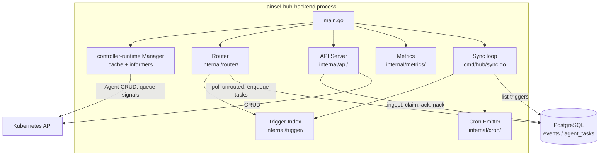
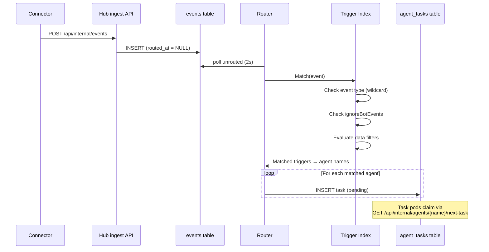
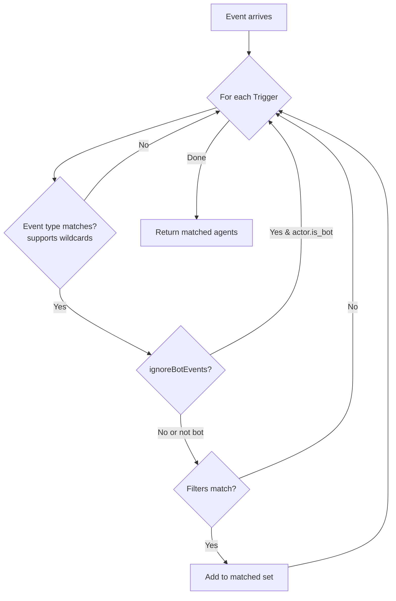
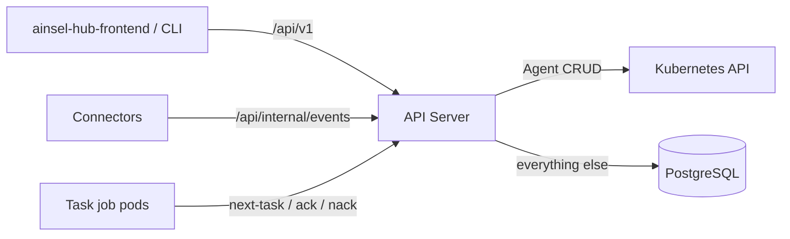

# Ainsel Hub Backend Architecture

> The system-wide data flow lives in
> [`docs/architecture.md`](../../../docs/architecture.md). This document
> covers the hub process internals only.

## Overview

The hub backend is the central control plane of Ainsel. It combines an event
router, a trigger index, a cron emitter, and a REST API into a single
process. Its durable store is PostgreSQL: the `events` and `agent_tasks`
tables form the event queue, and the same database holds triggers, cron
triggers, personas, skills, MCP servers, task logs and conversations.

## Component Structure

## Event Routing Flow

## Trigger Index

The trigger index is an in-memory structure that supports fast event
matching. Triggers are stored in Postgres (see
[`internal/triggers/`](../internal/triggers/)); a sync loop
([`cmd/hub/sync.go`](../cmd/hub/sync.go)) re-lists them every 30 seconds and
applies additions and deletions to the index.

## REST API

The API server serves two audiences:

- `/api/v1/*` — the operations console and external consumers: CRUD for
  agents (CRD-backed) and for triggers, personas, skills, MCP servers and
  connectors (Postgres-backed), plus observability endpoints.
- `/api/internal/*` — machine callers: connector event ingest, task
  pickup/ack/nack for per-task job pods, task-log ingest.

### Handler Structure

| File | Endpoints |
|------|-----------|
| `handlers_agents.go` | `/api/v1/agents`, `/api/v1/agents/:name` |
| `handlers_connectors.go` | `/api/v1/connectors`, `/api/v1/connectors/:name` |
| `handlers_triggers.go` | `/api/v1/triggers`, `/api/v1/triggers/:name` |
| `handlers_eventqueue.go` | `/api/internal/agents/{name}/next-task`, `ack`, `nack` |
| `server.go` | Route registration, health check, JSON helpers |
